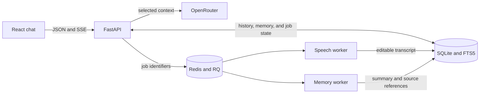

# psyholuh

A local-first chat for talking things through by text or voice. Each conversation keeps its chosen OpenRouter model, its original messages, and a memory that can point back to what you said.

## Run the demo

Install Docker with Compose and run the following command from the repository root.

```sh
docker compose up --build
```

Open [localhost:8080](http://localhost:8080). The demo uses fictional conversations and a deterministic adapter with its own SQLite database. It needs no OpenRouter key.

Open **«Встреча в пятницу»** and ask **«На какой день перенесли встречу?»**. The answer uses the corrected date, Friday. Open **Память** and follow the source to see the original correction. The demo runs the same context selection used in personal mode.

## Start a personal conversation

Copy `.env.example` to `.env`, set `PSYHOLUH_DEMO=0`, and add your `OPENROUTER_API_KEY`. Start Compose again. Create a chat and choose its model. Opening another chat changes the active conversation without changing either chat's model or history.

The microphone and file picker create an editable transcript. Review it before sending. The speech worker runs `faster-whisper` locally. If its model is missing, the first real transcription can take longer while the model downloads. Successful transcription removes the temporary recording and keeps the text draft.

Personal messages are stored on the computer. When you send a message, OpenRouter receives its text and the context selected for that reply. If memory compression uses a hosted model, it also receives the messages being compressed and the previous summary. Audio is processed locally.

## Architecture



- The API builds each prompt from the current turn, recent unsummarized messages, a bounded summary, and relevant excerpts from the same chat.
- The summary records the last message it covers. The API retains the uncovered tail until compression catches up and records which excerpts it sent.
- SQLite durably records queued work and its outcomes. The audio and memory workers run independently. Reconciliation restores pending work after a service stops, and replay uses stable request and job identifiers.

Read the product requirements and acceptance scenarios in [SPEC.md](SPEC.md). Both the browser and the API use the [OpenAPI contract](api/openapi.yaml).

Run `docker compose down` to stop the local services. The named data volumes retain conversations and downloaded speech models.
